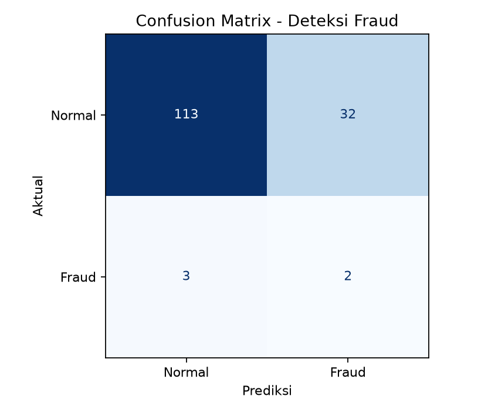

# LAPORAN PRAKTIKUM DATA MINING
## Evaluasi Model Klasifikasi: Confusion Matrix, Accuracy, Precision, Recall, dan F1-Score

**Nama:** _(isi nama)_<br>
**NIM:** _(isi NIM)_<br>
**Kelas:** _(isi kelas)_<br>
**Tanggal:** 25 November 2026<br>
**Program Studi Informatika, Fakultas Teknik, Universitas Negeri Padang**

---

## BAB I PENDAHULUAN

### 1.1 Tujuan

Praktikum ini bertujuan agar mahasiswa mampu:

1. Mengidentifikasi True Positive (TP), True Negative (TN), False Positive (FP), dan False Negative (FN) pada hasil klasifikasi.
2. Menghitung accuracy, precision, recall, dan F1-score secara manual dari confusion matrix.
3. Menghasilkan prediksi klasifikasi dan mengevaluasinya menggunakan Python dan scikit-learn.
4. Memvisualisasikan confusion matrix dan menginterpretasikan kesalahan prediksi.
5. Menjelaskan mengapa accuracy saja dapat menyesatkan pada data tidak seimbang, serta mengusulkan metrik yang lebih sesuai.

### 1.2 Konteks dan Deskripsi Dataset

Studi kasus yang digunakan adalah deteksi fraud (penipuan) pada transaksi pembayaran digital. Dataset dibangkitkan secara sintetis dan deterministik menggunakan `numpy.random.default_rng(42)`, sehingga hasil praktikum dapat direproduksi persis. Data ini merupakan simulasi pembelajaran, bukan data transaksi riil, dan tidak mengandung informasi pribadi.

Dataset terdiri atas 500 transaksi dengan empat fitur prediktor dan satu label target:

| Fitur | Tipe | Keterangan |
|---|---|---|
| `amount` | kontinu | Nominal transaksi (satuan simulasi), dibangkitkan dari distribusi lognormal |
| `hour` | diskret 0–23 | Jam terjadinya transaksi |
| `new_device` | biner 0/1 | Penanda perangkat baru, peluang 0,25 |
| `foreign_ip` | biner 0/1 | Penanda IP luar negeri, peluang 0,12 |
| `isFraud` | biner 0/1 | Label target: 1 = fraud, 0 = normal |

Label dibangkitkan dari model logistik atas fitur-fitur tersebut, dengan bobot positif pada `foreign_ip` (1,5), `new_device` (1,1), `hour < 5` (0,7), dan `amount > 300` (0,45), serta intersep −4,5. Karena intersep besar dan negatif, kelas fraud menjadi langka: dari 500 transaksi hanya **16 transaksi (3,20%)** berlabel fraud, sedangkan 484 transaksi (96,80%) berlabel normal. Kondisi ini sengaja dipilih agar persoalan data tidak seimbang (class imbalance) dapat dianalisis pada BAB III.

---

## BAB II LANGKAH PENGERJAAN

Seluruh langkah dijalankan dengan skrip `eval_fraud.py` menggunakan Python 3, pandas, numpy, scikit-learn 1.9.1, dan matplotlib 3.11.2. Perintah eksekusi:

```
.venv/bin/python eval_fraud.py > output.txt
```

### 2.1 Pembangkitan Dataset (Bagian 4.1)

Dataset dibangkitkan dengan `np.random.default_rng(42)` dan ukuran sampel 500. Skor linear dihitung dari kombinasi fitur, lalu dilewatkan ke fungsi sigmoid untuk memperoleh peluang fraud; label diambil dari distribusi Bernoulli dengan peluang tersebut.

Lima baris pertama dataset:

| amount | hour | new_device | foreign_ip | isFraud |
|---|---|---|---|---|
| 201.28 | 9 | 0 | 0 | 0 |
| 52.46 | 8 | 0 | 0 | 0 |
| 314.33 | 17 | 1 | 0 | 0 |
| 380.15 | 3 | 0 | 0 | 0 |
| 21.09 | 5 | 1 | 0 | 0 |

Distribusi kelas: 484 transaksi normal (96,80%) dan 16 transaksi fraud (3,20%).

### 2.2 Pembagian Data dan Pelatihan Model (Bagian 4.2)

Data dibagi menjadi data latih dan data uji dengan proporsi 70:30 dan `stratify=y` agar proporsi kelas terjaga. Model yang digunakan adalah `DecisionTreeClassifier` dengan `max_depth=4`, `class_weight='balanced'`, dan `random_state=42`.

Hasil: data latih 350 baris, data uji 150 baris, dengan 5 transaksi fraud di data uji (3,33%). Pohon yang terbentuk memiliki kedalaman 4 dan 12 leaf. Pembatasan kedalaman mencegah pohon menghafal data latih, sedangkan `class_weight='balanced'` memberi bobot lebih besar pada kelas minoritas.

### 2.3 Confusion Matrix (Bagian 4.3)

Confusion matrix dihitung dengan `labels=[0, 1]`, sehingga susunannya adalah `[[TN, FP], [FN, TP]]`:

```
[[113  32]
 [  3   2]]
```

Diperoleh **TP = 2, TN = 113, FP = 32, FN = 3**. Artinya, hanya 2 dari 5 transaksi fraud pada data uji yang berhasil ditangkap, 3 transaksi fraud lolos, dan 32 transaksi normal salah ditandai sebagai fraud.

### 2.4 Perhitungan Manual dan Verifikasi scikit-learn (Bagian 4.4)

| Metrik | Perhitungan manual | Hasil manual | Hasil scikit-learn |
|---|---|---|---|
| Accuracy | (2 + 113) / 150 | 0,7667 | 0,7667 |
| Precision | 2 / (2 + 32) | 0,0588 | 0,0588 |
| Recall | 2 / (2 + 3) | 0,4000 | 0,4000 |
| F1-score | 2 × (0,0588 × 0,4000) / (0,0588 + 0,4000) | 0,1026 | 0,1026 |

Selisih absolut antara perhitungan manual dan fungsi `accuracy_score`, `precision_score`, `recall_score`, serta `f1_score` adalah 0 pada keempat metrik. Dengan demikian, perhitungan manual dan implementasi pustaka **sesuai sepenuhnya**; pembulatan hanya berpengaruh pada tampilan digit.

### 2.5 Visualisasi Confusion Matrix (Bagian 4.5)

Visualisasi dibuat dengan `ConfusionMatrixDisplay` dan disimpan sebagai `figures/confusion_matrix.png`:



*Gambar 1. Confusion matrix model Decision Tree pada data uji.*

Sel FN (3 transaksi) berisi transaksi fraud yang diprediksi normal; secara praktis kerugian tidak terdeteksi dan tidak ada tindakan pencegahan. Sel FP (32 transaksi) berisi transaksi normal yang diprediksi fraud; secara praktis transaksi pelanggan sah tertahan atau ditolak, sehingga menimbulkan keluhan dan kehilangan kepercayaan. Pada model ini FP jauh lebih banyak daripada TP, sehingga presisi sangat rendah.

### 2.6 Eksperimen Baseline Semua Normal (Bagian 4.7)

Baseline dibuat dengan memprediksi seluruh data uji sebagai kelas normal (`np.zeros`):

| Model | Accuracy | Precision (fraud) | Recall (fraud) | F1 (fraud) |
|---|---|---|---|---|
| Baseline semua normal | 0,9667 | 0,00 | 0,00 | 0,00 |
| Decision Tree (max_depth=4) | 0,7667 | 0,06 | 0,40 | 0,10 |

### 2.7 Eksperimen Ambang Prediksi (Bagian 4.8)

Peluang fraud diambil dari `predict_proba`, lalu kelas diprediksi ulang pada empat ambang:

| Threshold | Precision | Recall | F1 | TP | FP | FN | TN |
|---|---|---|---|---|---|---|---|
| 0,2 | 0,0588 | 0,4000 | 0,1026 | 2 | 32 | 3 | 113 |
| 0,4 | 0,0588 | 0,4000 | 0,1026 | 2 | 32 | 3 | 113 |
| 0,5 | 0,0588 | 0,4000 | 0,1026 | 2 | 32 | 3 | 113 |
| 0,7 | 0,0556 | 0,2000 | 0,0870 | 1 | 17 | 4 | 128 |

Probabilitas yang dihasilkan pohon hanya mengambil enam nilai diskret: 0,0000; 0,1826; 0,5424; 0,8486; 0,9391; dan 1,0000. Karena itu ambang 0,2; 0,4; dan 0,5 menghasilkan prediksi yang identik, karena semuanya berada di antara 0,1826 dan 0,5424.

---

## BAB III HASIL TUGAS

### 3.1 Tugas 1: Perhitungan Manual

Diketahui TP = 24, TN = 156, FP = 12, FN = 8. Total observasi = 200. Confusion matrix:

```
[[TN=156, FP=12]
 [FN= 8,  TP=24]]
```

| Metrik | Rumus | Perhitungan | Nilai |
|---|---|---|---|
| Accuracy | (TP + TN) / Total | 180 / 200 | 0,9000 |
| Precision | TP / (TP + FP) | 24 / 36 | 0,6667 |
| Recall | TP / (TP + FN) | 24 / 32 | 0,7500 |
| F1-score | 2PR / (P + R) | 2(0,6667)(0,7500) / 1,4167 | 0,7059 |

Interpretasi: accuracy 90% tampak tinggi, tetapi 8 transaksi fraud tetap lolos (FN = 8), yang berarti potensi kerugian langsung tidak terdeteksi. Sebanyak 12 transaksi normal menerima alarm palsu (FP = 12), yang berarti pelanggan sah dapat mengalami penolakan transaksi. Precision 66,67% menunjukkan bahwa dua dari tiga alarm fraud yang dikeluarkan benar, sedangkan recall 75% menunjukkan tiga dari empat fraud aktual berhasil ditemukan. F1-score 70,59% merangkum keseimbangan keduanya.

### 3.2 Tugas 2: Verifikasi dengan Python

Ringkasan hasil eksekusi Bagian 4.1–4.5:

| Item | Hasil |
|---|---|
| Jumlah data | 500 transaksi (484 normal, 16 fraud) |
| Data latih / uji | 350 / 150 |
| TP / TN / FP / FN | 2 / 113 / 32 / 3 |
| Accuracy | 0,7667 |
| Precision | 0,0588 |
| Recall | 0,4000 |
| F1-score | 0,1026 |

Perhitungan manual pada Bagian 2.4 menghasilkan nilai yang sama persis dengan `accuracy_score`, `precision_score`, `recall_score`, dan `f1_score` (selisih 0). Confusion matrix juga sesuai dengan susunan `[[TN, FP], [FN, TP]]` karena argumen `labels=[0, 1]` diberikan secara eksplisit. Kesesuaian ini menunjukkan bahwa rumus pada modul telah diimplementasikan dengan benar dan bahwa `cm.ravel()` mengembalikan urutan TN, FP, FN, TP sesuai dokumentasi scikit-learn.

Perlu dicatat bahwa nilai metrik pada bagian ini berasal dari eksekusi nyata dan berbeda dari contoh manual pada modul (TP=15, TN=75, FP=5, FN=5). Perbedaan tersebut wajar karena contoh pada modul hanya ilustrasi rumus, bukan keluaran model.

### 3.3 Tugas 3: Evaluasi Data Tidak Seimbang

Perbandingan baseline dan Decision Tree:

| Model | Accuracy | Recall fraud | Jumlah FN | Jumlah FP |
|---|---|---|---|---|
| Baseline semua normal | 0,9667 | 0,0000 | 5 | 0 |
| Decision Tree | 0,7667 | 0,4000 | 3 | 32 |

Baseline memperoleh accuracy **lebih tinggi** (96,67%) daripada model yang benar-benar dilatih (76,67%), padahal baseline tidak pernah mendeteksi satu pun fraud. Penyebabnya adalah komposisi data uji: 145 dari 150 transaksi (96,67%) berlabel normal, sehingga menebak "semua normal" otomatis benar pada hampir seluruh data. Accuracy menjadi ukuran yang didominasi kelas mayoritas dan tidak lagi mencerminkan kemampuan mendeteksi kelas yang justru menjadi tujuan sistem.

Sebaliknya, recall fraud baseline bernilai 0 karena seluruh fraud masuk ke sel FN. Model Decision Tree menurunkan accuracy hingga 20 poin persentase, tetapi berhasil menaikkan recall fraud menjadi 40% dan menurunkan FN dari 5 menjadi 3. Pada konteks fraud, pertukaran ini umumnya dapat diterima: biaya satu fraud yang lolos jauh melebihi biaya satu alarm palsu.

Karena itu, evaluasi pada data tidak seimbang sebaiknya melaporkan recall, precision, dan F1-score per kelas (khususnya kelas minoritas), serta macro average atau precision-recall AUC, bukan accuracy tunggal. Pada eksperimen ini macro F1 baseline 0,49 dan Decision Tree 0,48; keduanya rendah dan saling berdekatan, sedangkan accuracy keduanya berbeda 20 poin. Angka ini menegaskan bahwa accuracy saja menyesatkan.

### 3.4 Tugas 4: Eksperimen Threshold dan Rekomendasi

Tabel hasil (dari Bagian 2.7):

| Threshold | Precision | Recall | F1 | FP | FN |
|---|---|---|---|---|---|
| 0,2 | 0,0588 | 0,4000 | 0,1026 | 32 | 3 |
| 0,4 | 0,0588 | 0,4000 | 0,1026 | 32 | 3 |
| 0,5 | 0,0588 | 0,4000 | 0,1026 | 32 | 3 |
| 0,7 | 0,0556 | 0,2000 | 0,0870 | 17 | 4 |

Pembahasan:

1. **Ambang 0,2; 0,4; dan 0,5 identik.** Penurunan ambang tidak selalu menaikkan recall secara bertahap apabila skor model bersifat diskret. Pohon keputusan menghasilkan satu peluang per leaf, dan keenam nilai peluang yang muncul (0,0000; 0,1826; 0,5424; 0,8486; 0,9391; 1,0000) tidak jatuh di antara ambang-ambang tersebut. Akibatnya, transaksi hanya berpindah kelas ketika ambang melewati salah satu nilai leaf.
2. **Ambang 0,7 menurunkan recall dan menaikkan FN.** Pada ambang ini, satu transaksi fraud yang sebelumnya terdeteksi berpindah menjadi FN (FN 3 menjadi 4), sementara 15 transaksi normal berhenti menerima alarm palsu (FP 32 menjadi 17). Precision tidak membaik secara berarti (0,0588 menjadi 0,0556) karena TP juga berkurang dari 2 menjadi 1.
3. **Pola tidak monoton.** Pada dataset kecil (5 fraud di data uji), satu perpindahan transaksi mengubah recall sebesar 20 poin persentase. Kesimpulan harus didasarkan pada output nyata, bukan asumsi bahwa menurunkan ambang selalu menaikkan recall.

**Rekomendasi.** Untuk skenario biaya FN jauh lebih tinggi daripada FP, ambang yang dipilih adalah **0,2**. Alasannya, ambang 0,2 memberikan recall tertinggi yang tersedia (0,4000) dengan FN terendah (3) tanpa tambahan FP dibandingkan ambang 0,5 (FP tetap 32), dan secara tegas lebih baik daripada ambang 0,7 yang menambah FN menjadi 4. Konsekuensi yang harus diterima adalah 32 alarm palsu, atau sekitar 22% dari 145 transaksi normal pada data uji.

Namun perlu dinyatakan secara kritis: precision 5,88% menunjukkan bahwa dari 34 alarm yang dikeluarkan, hanya 2 yang benar. Angka ini terlalu rendah untuk operasional. Penurunan ambang saja tidak menyelesaikan masalah, karena penyebab utamanya adalah keterbatasan model (kedalaman dibatasi 4 dan data latih hanya 350 baris dengan 11 kasus fraud). Perbaikan yang lebih tepat adalah:

1. Memakai model yang menghasilkan skor kontinu, misalnya regresi logistik atau random forest, agar ambang benar-benar dapat disetel secara halus.
2. Menerapkan pembelajaran sensitif biaya (cost-sensitive learning) dengan matriks biaya eksplisit untuk FN dan FP.
3. Menambah data fraud atau menerapkan resampling/oversampling pada kelas minoritas.
4. Melaporkan precision-recall AUC dan interval kepercayaan, karena dengan 5 kasus fraud di data uji, satu kesalahan prediction menggeser metrik secara drastis.

---

## BAB IV PEMBAHASAN DAN KESIMPULAN

### 4.1 Pembahasan

Empat metrik yang diuji saling melengkapi dan tidak dapat saling menggantikan. Accuracy mengukur proporsi prediksi benar secara keseluruhan, tetapi pada data dengan rasio 96,8% berbanding 3,2% metrik ini didominasi kelas mayoritas. Hasil eksperimen membuktikan hal tersebut secara langsung: model yang tidak pernah mendeteksi fraud (baseline) memperoleh accuracy 96,67%, lebih tinggi daripada model yang dilatih (76,67%). Dengan demikian, accuracy yang tinggi tidak dapat dijadikan bukti bahwa sistem mampu mendeteksi fraud.

Precision dan recall mengukur dua jenis kesalahan yang berbeda dan berlawanan arah. Precision menilai ketepatan alarm: dari semua transaksi yang ditandai fraud, berapa banyak yang benar-benar fraud. Recall menilai cakupan: dari semua fraud aktual, berapa banyak yang berhasil ditemukan. Pada model Decision Tree ini, recall 40% berarti 3 dari 5 fraud lolos, sedangkan precision 5,88% berarti 32 dari 34 alarm salah sasaran. Kombinasi ini menunjukkan model yang terlalu agresif menandai fraud namun tidak cukup tepat memilihnya, yaitu gejala umum pada data tidak seimbang dengan pohon dangkal.

F1-score sebagai rata-rata harmonik menahan kedua efek tersebut dan menghasilkan nilai rendah (0,1026), lebih jujur menggambarkan kualitas model daripada accuracy 0,7667. Perbandingan macro F1 antara baseline (0,49) dan model (0,48) juga menunjukkan bahwa secara agregat kedua model masih lemah; yang membedakan keduanya adalah kemampuan mendeteksi kelas minoritas, bukan angka accuracy.

Eksperimen ambang prediksi memperlihatkan bahwa ambang adalah tuas kebijakan (policy lever), bukan parameter yang dinilai secara universal. Ambang optimal bergantung pada rasio biaya FN dan FP. Pada kasus ini, karena probabilitas pohon bersifat diskret, tuas tersebut hanya bergerak pada nilai-nilai tertentu; ambang 0,2; 0,4; dan 0,5 berperilaku sama, dan hanya ambang 0,7 yang mengubah hasil. Temuan ini penting secara metodologis: penurunan ambang tidak otomatis menaikkan recall, dan kesimpulan harus selalu didasarkan pada output nyata.

Keterbatasan praktikum ini adalah ukuran sampel uji yang kecil (150 baris) dengan hanya 5 kasus fraud. Satu perubahan prediksi menggeser recall sebesar 20 poin persentase, sehingga ketidakpastian metrik sangat besar. Dataset juga sintetis dan dibangkitkan dari model logistik yang sederhana, sehingga tidak mewakili kompleksitas pola fraud nyata.

### 4.2 Kesimpulan

1. Confusion matrix model Decision Tree pada data uji utama (150 transaksi, 30% dari 500) adalah `[[113, 32], [3, 2]]`, dengan TP = 2, TN = 113, FP = 32, dan FN = 3.
2. Perhitungan manual menghasilkan accuracy 0,7667; precision 0,0588; recall 0,4000; dan F1-score 0,1026, identik dengan hasil scikit-learn (selisih 0).
3. Untuk confusion matrix TP = 24, TN = 156, FP = 12, FN = 8 (Tugas 1), diperoleh accuracy 90,00%; precision 66,67%; recall 75,00%; dan F1-score 70,59%.
4. Pada data tidak seimbang, accuracy menyesatkan: baseline semua normal mencapai 96,67% tetapi recall fraud 0%. Metrik yang lebih sesuai adalah recall, precision, dan F1-score kelas fraud, serta macro average dan precision-recall AUC.
5. Ambang 0,2; 0,4; dan 0,5 menghasilkan performa identik (precision 0,0588; recall 0,4000) karena probabilitas pohon bersifat diskret, sedangkan ambang 0,7 menurunkan recall menjadi 0,2000 dan menaikkan FN dari 3 menjadi 4.
6. Untuk skenario dengan biaya FN lebih tinggi daripada FP, rentang ambang 0,2–0,5 direkomendasikan karena memberi recall tertinggi (0,4000) dengan FN terendah (3) tanpa tambahan FP dibandingkan ambang 0,7. Di dalam rentang yang seri tersebut, ambang 0,2 dipilih sebagai batas bawah karena paling toleran terhadap variasi skor model pada data lain. Namun precision 5,88% menunjukkan bahwa perbaikan model (model probabilistik kontinu, cost-sensitive learning, penambahan data fraud) diperlukan sebelum sistem layak dioperasikan.

---

## DAFTAR PUSTAKA

<p style="padding-left:2em;text-indent:-2em">Han, J., Kamber, M., &amp; Pei, J. (2012). <em>Data mining: Concepts and techniques</em> (3rd ed.). Morgan Kaufmann.</p>

<p style="padding-left:2em;text-indent:-2em">Pedregosa, F., Varoquaux, G., Gramfort, A., Michel, V., Thirion, B., Grisel, O., Blondel, M., Prettenhofer, P., Weiss, R., Dubourg, V., Vanderplas, J., Passos, A., Cournapeau, D., Brucher, M., Perrot, M., &amp; Duchesnay, É. (2011). Scikit-learn: Machine learning in Python. <em>Journal of Machine Learning Research, 12</em>, 2825–2830.</p>

<p style="padding-left:2em;text-indent:-2em">Scikit-learn developers. (2024). <em>Model evaluation: Quantifying the quality of predictions</em>. https://scikit-learn.org/stable/modules/model_evaluation.html</p>

<p style="padding-left:2em;text-indent:-2em">Tan, P.-N., Steinbach, M., Karpatne, A., &amp; Kumar, V. (2019). <em>Introduction to data mining</em> (2nd ed.). Pearson.</p>
